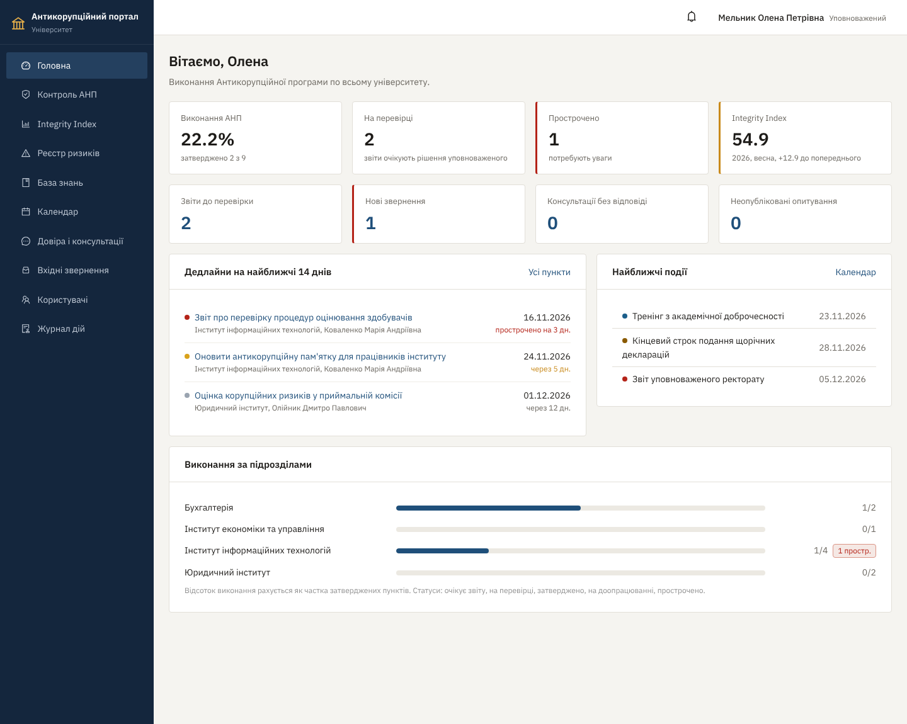
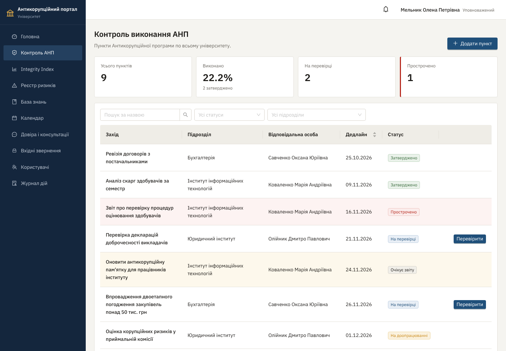
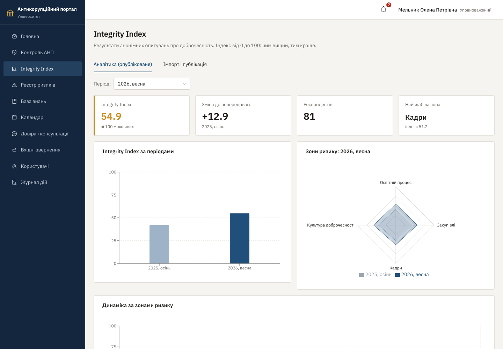
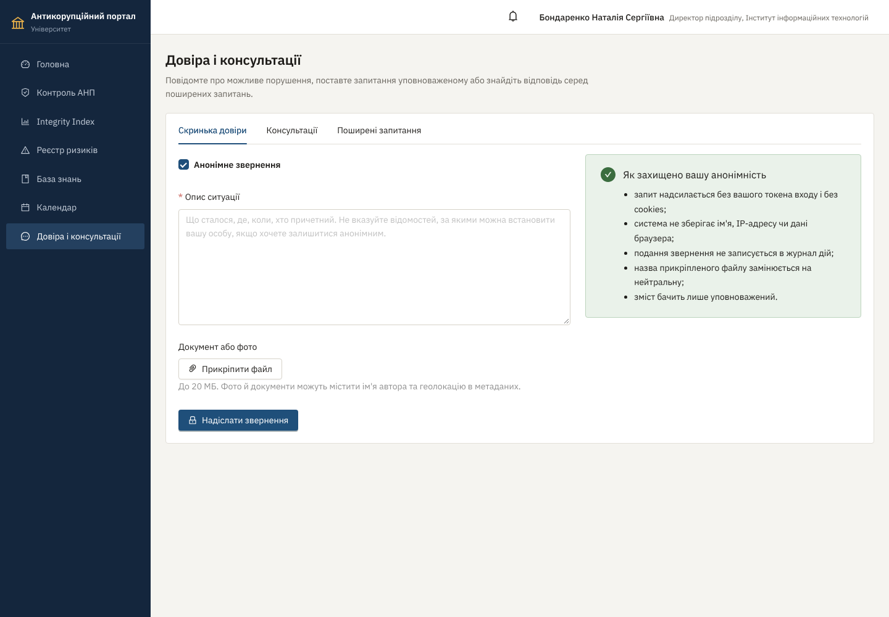
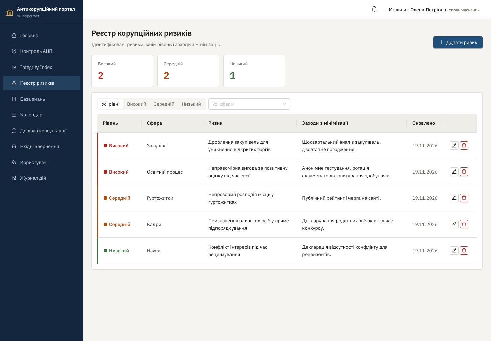
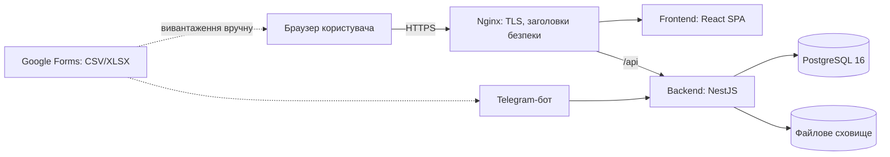

# Антикорупційний вебпортал університету

Єдиний захищений портал для антикорупційного уповноваженого, ректорату, директорів підрозділів і відповідальних осіб: контроль виконання Антикорупційної програми, аналітика анонімних опитувань (Integrity Index), реєстр ризиків, база знань і Скринька довіри.



## Проблема і користувач

**Користувачі:** антикорупційний уповноважений університету; ректор і проректори; директори інститутів та інших підрозділів; відповідальні особи на місцях; адміністратор системи.

**Проблема.** Антикорупційна програма (АНП) університету містить десятки заходів із дедлайнами в різних підрозділах. Без спільного інструмента уповноважений:

* збирає звіти електронною поштою й паперовими листами та вручну нагадує про дедлайни;
* зводить виконання в Excel, тому ректорат бачить картину лише раз на квартал і із запізненням;
* обробляє вивантаження анонімних опитувань з Google Forms вручну, а сирі відповіді розходяться в пошті;
* не має каналу, де працівник може повідомити про порушення анонімно, без ризику, що його ідентифікують за поштою чи IP-адресою;
* не може довести, хто і коли бачив чутливі дані.

## Що робить рішення

| Модуль | Що отримує користувач |
|---|---|
| Контроль АНП | Пункти програми з дедлайнами й відповідальними; відповідальна особа подає звіт із файлом, уповноважений затверджує або повертає з коментарем; прострочені пункти позначаються автоматично щодня |
| Integrity Index | Імпорт CSV/XLSX з Google Forms (у вебінтерфейсі або через Telegram-бота), розрахунок індексу 0–100 за зонами ризику, графіки динаміки; сирі файли бачить лише уповноважений, інші ролі отримують агреговані дані після публікації |
| Реєстр ризиків | Ризики за сферами з рівнем (високий, середній, низький) і заходами з мінімізації |
| База знань | Курси, пам'ятки, шаблони документів і нормативні акти |
| Календар | Навчання, декларування, дедлайни; дедлайни АНП додаються автоматично в межах доступу користувача |
| Скринька довіри | Анонімне звернення: без токена входу, IP-адреси й даних браузера, без запису в журнал; бачить лише уповноважений |
| Консультації і FAQ | Запитання уповноваженому (бачать лише автор і уповноважений) та відповіді на поширені запитання |
| Нагадування і журнал дій | Внутрішні нагадування про дедлайни; кожне затвердження, публікація й перегляд звернення фіксуються в журналі |

Права розмежовані за п'ятьма ролями на сервері: директор бачить лише свій підрозділ, відповідальна особа лише свої пункти, ректорат лише опубліковані підсумки опитувань. Матриця доступів: [docs/architecture.md](docs/architecture.md#рольова-модель).

## Демонстрація

**Відео (до 3 хвилин):** []

Сценарій відео: [docs/demo-script.md](docs/demo-script.md).

Демо-доступи (пароль для всіх `Demo-Portal-2026`):

| Email | Роль |
|---|---|
| officer@univ.edu.ua | Антикорупційний уповноважений |
| rector@univ.edu.ua | Ректорат |
| director@univ.edu.ua | Директор інституту |
| responsible@univ.edu.ua | Відповідальна особа |
| admin@univ.edu.ua | Адміністратор |

| | |
|---|---|
|  |  |
|  |  |

## Як запустити

Потрібен лише [Node.js 22 або новіший](https://nodejs.org). PostgreSQL встановлювати не треба: для показу база запускається з папки проєкту.

```powershell
git clone https://github.com/krendelokk/Vector/tree/main
cd Anticoruption-portal/anticorruption-portal
npm run dev
```

Перший запуск сам встановлює залежності, створює демо-базу й заповнює її демо-даними (кілька хвилин). Коли все готово, браузер відкриється на `http://localhost:5173`. `Ctrl+C` зупиняє все разом із базою.

Розгортання на сервері університету (Docker Compose, Nginx, HTTPS), запуск тестів і змінні середовища: [docs/developer-guide.md](docs/developer-guide.md).

## Як влаштовано



* **Frontend:** React 18, TypeScript, Vite, Ant Design, Recharts, TanStack Query, React Hook Form + Zod.
* **Backend:** NestJS (TypeScript), Prisma 7, PostgreSQL 16; модулі за доменами (АНП, опитування, ризики, база знань, календар, Скринька довіри, нагадування, журнал дій, Telegram-бот).
* **Безпека:** JWT (access 15 хв, refresh у httpOnly-cookie з ротацією), bcrypt, перевірка ролі й підрозділу на кожному ендпоінті за принципом "заборонено, якщо не дозволено явно", перевірка вмісту файлів за сигнатурою, блокування облікового запису після 5 невдалих спроб входу.
* **Якість:** 27 автоматичних тестів, зокрема наскрізна перевірка матриці доступів; CI на GitHub Actions.

Детально: [docs/architecture.md](docs/architecture.md).

## Документація

| Документ | Зміст |
|---|---|
| [docs/architecture.md](docs/architecture.md) | Опис архітектури: компоненти, модель даних, рольова модель, безпека, розгортання |
| [docs/time-savings.md](docs/time-savings.md) | Розрахунок економії часу |
| [docs/integration-map.md](docs/integration-map.md) | Карта інтеграції із системами університету |
| [docs/abuse-analysis.md](docs/abuse-analysis.md) | Аналіз зловживань і запобіжників |
| [docs/ai.md](docs/ai.md) | Як ми використовували інструменти ШІ |
| [docs/demo-script.md](docs/demo-script.md) | Сценарій демонстраційного відео |
| [docs/developer-guide.md](docs/developer-guide.md) | Інструкція розробника: запуск, Docker, ролі, тести, структура |

## Що використали

* **Мови й фреймворки:** TypeScript, Node.js 22, NestJS 11, React 18, Vite.
* **Дані:** PostgreSQL 16, Prisma 7, embedded-postgres (демо-режим без встановлення бази), SheetJS (читання CSV/XLSX).
* **Інтерфейс:** Ant Design 5, Recharts, FullCalendar.
* **Інтеграції:** grammY (Telegram-бот), Google Forms (вивантаження CSV/XLSX), Sentry (необов'язково).
* **Інфраструктура:** Docker Compose, Nginx, Let's Encrypt або сертифікат внутрішнього CA, GitHub Actions.
* **Тести:** Jest, Supertest, Playwright (ручна наскрізна перевірка інтерфейсу).
* **Інструменти ШІ:** див. [docs/ai.md](docs/ai.md).
